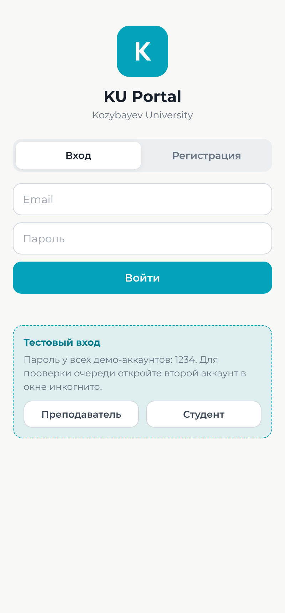
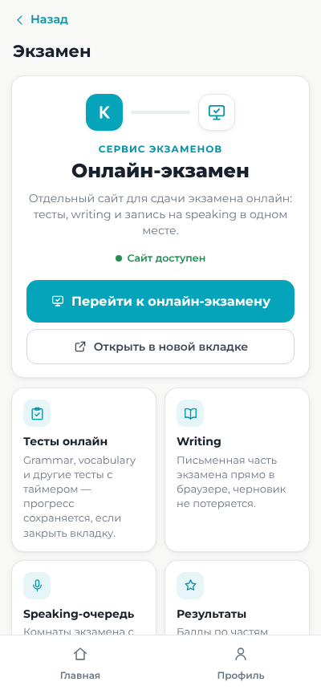
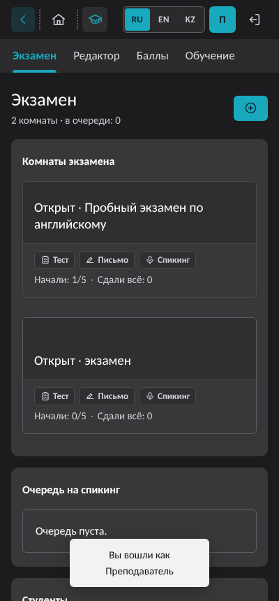

# KU Portal

Портал для студентов и преподавателей Kozybayev University: расписание, оценки, рейтинг группы, онлайн-экзамен и помощник по вопросам о вузе.

Работает на чистом Node.js, внешние зависимости не нужны.

Портал, API, онлайн-экзамен и KU Message работают на одном сервере. [Основной сайт на alwaysdata](https://ku-portal.alwaysdata.net/)

Карта серверного кода, команды подтверждения и отзыва доступа, переход со старой базы, журналы и восстановление описаны в [руководстве по бэкенду](docs/BACKEND.md).

| Вход | Раздел «Экзамен» | Онлайн-экзамен |
|:---:|:---:|:---:|
|  |  |  |

## Запуск

Нужен Node.js 18 или новее.

```bash
git clone https://github.com/SAKEDA-hub/ku-portal.git
cd ku-portal
node server.js
```

Портал откроется по адресу http://localhost:3000. С телефона в той же Wi-Fi сети: `http://<IP компьютера>:3000`.

## Тестовые аккаунты

Создаются только в отдельном режиме `DEMO=1` в каталоге `data/demo/`. У пяти портальных аккаунтов индивидуальные случайные пароли; публичный быстрый вход выключен. Экзаменационные тестовые аккаунты ведутся отдельно в базе exam-sync.

| Роль | Email | Кто | Направление |
|---|---|---|---|
| Преподаватель | `teacher@demo.kz` | Ахметова Айгерим Сериковна — английский, математика, политология | Языки |
| Преподаватель | `teacher2@demo.kz` | Сейткали Ерлан Маратович — Python, базы данных | IT |
| Преподаватель | `teacher3@demo.kz` | Жумабекова Динара Ерлановна — биохимия, микробиология | Биотехнологии |
| Студент | `student@demo.kz` | Иванов Данияр, группа ИСУ-26-2-а | IT |
| Студент | `student2@demo.kz` | Каримов Алихан, группа БТ-26-1-а | Биотехнологии |
| Менеджер | `manager@demo.kz` | Омарова Сауле Кайратовна — все клубы и общежитие | — |
| Руководитель клубов | `clubs@demo.kz` | Нурланов Арман Бекович — «Волонтёрство» и «Футбол» | — |

Направление студента определяется по группе: **ИСУ** — IT, **БТ** — биотехнологии; у преподавателя — по кафедре.

## Роли

| Роль | Что доступно | Как назначается |
|---|---|---|
| Студент | расписание, оценки, рейтинг, экзамен, KU Message, заявки в клубы, обращения в общежитие | регистрация + `approve` |
| Преподаватель | занятия и оценки своих групп, предметы и переписка в KU Message, экзамен. Клубов и общежития нет | регистрация + `approve` + `groups` |
| Руководитель клуба | заявки, канал, мероприятия и посещаемость только своих клубов | `role <ID> club-lead "volunteer,football"` |
| Менеджер | все клубы, администрация общежития, учебная база результатов | `role <ID> manager` |
| Администрация общежития | обращения и новости общежития | `role <ID> dorm` |
| Администратор | всё, что у менеджера, и **админ-панель** `/admin/` | `role <ID> admin` |

**Учебная база результатов** (`/results/`) — ведомость баллов по тестам (тесты, письмо, говорение) для всех групп. Доступ только преподавателям и администрации: они открывают её из портала без пароля и могут выставлять баллы. Студентам и руководителям клубов она закрыта.

Менеджер и руководитель клуба регистрируются как «Сотрудник»: у них нет учёбы и экзамена, только назначенные обязанности. Служебную роль можно выдать и преподавателю или студенту — она добавляется к основной. Снять: `role <ID> none`. Команды — в [руководстве по бэкенду](docs/BACKEND.md).

Чтобы открыть список портальных тестовых паролей, заберите приватный `data/demo/demo-credentials.json` через SFTP после запуска демонстрационного экземпляра. Не запускайте `DEMO=1` в рабочем экземпляре: он использует отдельное хранилище.

В рабочем режиме (`DEMO=0`, по умолчанию) регистрации подтверждает администратор.

### Админ-панель

Плитка «Администрирование» на главной (или `https://<сайт>/admin/`) — для пользователей с правом `admin`. Вход по сеансу портала, без отдельного пароля.

- **Заявки** — вкладка «Ожидают подтверждения»: «Подтвердить» (преподавателю сразу указываются его группы).
- **Доступ** — «Закрыть доступ» выкидывает пользователя из портала и KU Message сразу; данные остаются.
- **Права** — админ-панель, учебная база, общежитие, все клубы или отдельные клубы.
- **Сам пользователь** восстанавливает пароль ссылкой «Забыли пароль?» на экране входа (письмо на почту).
- **Сбросить пароль** — если письмо не дошло: панель покажет временный пароль один раз, все входы пользователя завершатся, при входе портал попросит задать свой. Можно отключить 2FA, если потерян телефон.
- **Удалить** — с вводом email пользователя; у преподавателя выставленные оценки остаются у студентов.
- **Скачать копию базы** — один JSON-файл со всеми данными портала.

Сброс пароля, удаление и копия базы спрашивают пароль администратора (раз в час). Все действия пишутся в журнал `data/audit/`. Себя нельзя удалить, лишить доступа или права администратора — первого администратора назначают командой `node scripts/access.js role <ID> admin` по SSH. Без панели те же действия выполняют команды из [руководства по бэкенду](docs/BACKEND.md), включая `node scripts/access.js reset-password <ID>`.

## Настройки и темы

**Портал** — «Кабинет» (личный кабинет): профиль и все настройки на одном экране, слева (на телефоне — сверху) оглавление разделов. Все разделы работают:
- **Оформление**: тема — светлая / тёмная / как в системе; цвет сайта — «Авто» (по программе пользователя), Kozybayev, Arizona, изумрудный, фиолетовый, коралловый, графит, розовый; размер текста (4 уровня), компактный режим, меньше анимации. Всё это переносится в онлайн-экзамен;
- **Язык**: русский, қазақша, English — переводится весь интерфейс, выбор передаётся в онлайн-экзамен;
- **Уведомления**: новые оценки, изменения расписания, открытие экзамена в онлайн-экзамене, вход с нового устройства — в портале (колокольчик со счётчиком), со звуком и уведомлениями браузера (по разрешению); каждый тип можно выключить. Email-рассылка недоступна — на сервере не настроена отправка почты;
- **Безопасность**: смена пароля (с выходом на других устройствах), двухфакторная аутентификация по коду из приложения (Google Authenticator, Microsoft Authenticator, Aegis…), оповещение о входе с нового устройства, активные сеансы с возможностью завершить;
- **Конфиденциальность**: скрыть себя в рейтинге группы, статус «в сети», скачать свои данные (JSON);
- **Аккаунт**: удаление с подтверждением паролем. У тестовых аккаунтов смена пароля, 2FA и удаление отключены — они общие.

**Онлайн-экзамен** — шестерёнка или аватар в верхней панели → панель «Настройки» (всё работает):
- **цвет** — inCampus (Kozybayev), University of Arizona и палитры портала (изумрудный, фиолетовый, коралловый, графит, розовый); **тема** — авто / светлая / тёмная / как в системе; **размер текста**, **высокая контрастность**, **меньше анимации**;
- **язык** RU / EN / KZ;
- **уведомления**: звук и вибрация при вызове на speaking, уведомление об открытии экзамена, уведомления браузера, кнопка проверки;
- **экзамен**: показывать таймер (если выключить — появится в последнюю минуту), подтверждать отправку теста;
- **аккаунт**: смена пароля, выход.

**Переход из портала в экзамен** сохраняет оформление: цвет (включая «Авто»), тему, размер текста и «меньше анимации». Выбор в настройках экзамена перебивает пришедшее из портала.

**Программа пользователя** — Kozybayev University или University of Arizona (выбирается при регистрации). От неё зависят цвет «Авто» в портале и цвет онлайн-экзамена при переходе; тёмная/системная тема портала тоже передаётся в экзамен. Демо: `teacher@demo.kz` — University of Arizona, `student@demo.kz`, `student2@demo.kz` — Kozybayev University.

**Адаптивность:** телефон — одна колонка и нижнее меню; планшет (от 640 px) — шире колонка и сетки; ноутбук (от 1024 px) — верхнее меню, главная в две колонки, в кабинете слева профиль и оглавление, справа разделы в две колонки. Панель настроек экзамена — шторка снизу на телефоне и боковая панель справа на ноутбуке.

## Сервисы студента

Верхнее меню: **Главная, KU Message, Экзамен, Кабинет**. «KU Message» и «Экзамен» — страницы входа в отдельные сервисы: что нового, кнопка перехода (с анимацией «портал → сервис») и «Открыть в новой вкладке». На главной студента: **Рейтинг, Расписание, Успеваемость, Клубы, Общежитие, Голосование** (всё работает с сервером; опросы публикует администратор). У преподавателя: Добавить занятие, Оценки, Расписание, Клубы, Общежитие. Внизу — ссылка на сайт университета: https://stikech.github.io/ku-frontend/ku.edu.kz/ru/.

- **KU Message** — мессенджер университета, отдельное приложение по адресу `/ku-message/` (папка `ku-message/`), как онлайн-экзамен. Вход — пункт «KU Message» в верхнем меню (страница входа, как у экзамена, кнопка «Открыть KU Message» с той же анимацией); входить заново не нужно, оформление и язык портала переносятся. Логотип — плитка с двумя репликами диалога и надпись KU MESSAGE, как у онлайн-экзамена.
  - *Предметы* — у каждого предмета одна страница (для всех групп, где он стоит в расписании), как команда в Teams: вкладки **«Лекции»**, **«Практики»**, **«Задания»** (и «Материалы», если есть). Публикует только преподаватель предмета; лекции и практики идут по порядку (Лекция 1, 2, 3…), к каждой можно приложить файл (Word, PowerPoint, PDF и др., до 10 МБ). Задания — только с долгим сроком сдачи (не меньше 7 дней: проекты, курсовые, рефераты), с отсчётом «осталось N дн.».
  - *Чаты* — личная переписка студента с преподавателями его группы, с файлами и отметками о прочтении. Студент пишет сам; у преподавателя в «Чатах» только начатые переписки, а написать студенту можно из вкладки **«Ученики»** (студенты по группам).
  - *Преподавателю:* добавление и правка публикаций, быстрые ответы-шаблоны в чате, часы консультаций (видны студентам).
  - *Настройки* (шестерёнка → страница `#/settings`): профиль, оформление («как в KU Portal» или своя тема и цвет), чаты (отправка по Enter, предпросмотр), уведомления (браузер, звук, проверка), конфиденциальность («в сети», отметки о прочтении), быстрые ответы и часы консультаций (преподаватель), язык, аккаунт. В Кабинете портала настроек мессенджера нет.
  - *Телефон:* список и открытый экран сменяют друг друга, «Добавить» у преподавателя — круглая кнопка внизу, окна открываются снизу, поля ввода 16px (без увеличения страницы в iOS), отступы под вырез и жесты.
- **Клубы** — Футбол, Баскетбол, Волонтёрство, Дебатный клуб, Шахматы. У мероприятий есть время начала и окончания (часы в зачёт по умолчанию — длительность). Вкладки:
  - **«Клубы»** — все клубы, вступить/выйти;
  - **«Объявления»** — мероприятия *только тех клубов, где вы участник*, с записью (лимит мест, часы в зачёт активности). Пока не вступили — объявления клуба скрыты;
  - **«Моя активность»** — досье: сколько мероприятий посещено, часы волонтёрства, всего часов, клубы с датой вступления, предстоящие записи и история участия.
  - Регулярные встречи клуба появляются сами на ближайшую дату. Преподаватель — организатор: публикует объявления (описание, место, лимит, часы), видит всех записавшихся и после мероприятия отмечает, кто не пришёл — это сразу отражается в профиле активности студента.
- **Общежитие** — «Новости» (актуальная информация) и «Жалобы и ремонт»: обращения (ремонт, жалоба — можно анонимно, запрос) со статусами «Принята → В работе → Выполнена / Отклонена» и ответом администрации. Роль администрации пока выполняет преподаватель: публикует новости, меняет статусы, отвечает; студент получает уведомление.

## Онлайн-экзамен

Раздел «Экзамен» (пункт главного меню) сразу предлагает перейти в **«Онлайн-экзамен»** — сервис [exam-sync](https://github.com/StephCurrysvg/exam-sync), встроенный в этот же сервер по адресу `/exam-sync/`. Отдельный деплой не нужен.

- **Преподаватель:** редактор тестов, комнаты экзамена (тест + writing + speaking), очередь на speaking, ведомость.
- **Студент:** тесты с таймером, writing, запись на speaking, результаты.
- У экзамена отдельные аккаунты. Первый рабочий логин создаёт оператор командой `exam-reset`. В изолированном `DEMO=1` доступны студенты `user`, `user1`–`user4` / `1` и преподаватель `teacher` / `admin`.
- **Время не обнуляется при выходе:** у теста с лимитом и у письменной работы с лимитом (задаётся в комнате, 0 — без лимита) время идёт, даже если студент вышел, закрыл вкладку или сбросил тест. Преподавателю приходит уведомление, и он может остановить время, если студент вышел случайно.
- **Спикинг оценивается сразу:** после «Завершить» открывается окно балла только за спикинг; тест и письменную работу можно проверить позже.
- Вернуться в портал — кнопка «KU Portal» в верхней панели сайта экзаменов.
- Рабочие данные экзаменов сохраняются в `data/exam-sync.json`. Для отдельной демонстрационной базы начальные записи берутся из `exam-sync/seed.json`.

## Публикация для других людей

Схема: **весь проект — [alwaysdata](https://www.alwaysdata.com)**: портал, API, онлайн-экзамен и KU Message работают с одного адреса `https://<аккаунт>.alwaysdata.net`. Для этого же адреса уже настроена точка входа `/` в `public/`, а сервисы открываются по `/exam-sync/` и `/ku-message/`. `https://sakeda-hub.github.io/ku-portal/` можно оставить как прежний запасной адрес на время перехода; основной адрес — alwaysdata.

Обновление:
- **весь проект** — workflow `.github/workflows/deploy.yml` загружает код (включая `public/`, `exam-sync/` и `ku-message/`) на alwaysdata при push в `main`, если заданы секреты `ALWAYSDATA_*`. Без этих секретов код можно обновлять существующим скриптом `deploy/alwaysdata-update.sh` по расписанию или вручную.
- **данные** — хранятся на диске alwaysdata в `data/`; код и публикация сайта их не заменяют.
- Пароли пяти тестовых аккаунтов портала создаются индивидуально; публичный блок быстрого входа отключён. После запуска демонстрационного экземпляра заберите их по SFTP из `~/ku-portal/data/demo/demo-credentials.json`. Файл исключён из Git и доступен только владельцу аккаунта. Не публикуйте его и не кладите в `public/`.

### Учебная база результатов

- Раздел открывается с `/results/` и ссылается на отдельное серверное хранилище `data/results.json`; оно не использует клиентский `localStorage` и не попадает в GitHub.
- На Alwaysdata загрузите исходный `results.db` в `~/ku-portal/data/results.db`, затем выполните `python3 ~/ku-portal/tools/import_results_db.py ~/ku-portal/data/results.db` из SSH. Скрипт проверит целостность и суммы, перенесёт записи в `data/results.json`, создаст уникальные пароли и приватный `data/results-credentials.csv` (права 600). Существующие рабочие данные не заменяются без явного `--replace`.
- Заберите `results-credentials.csv` через SFTP и храните у себя в закрытом месте. В `results.json` хранятся только хеши паролей.
- Доступ только преподавателям и администрации (вход из портала без пароля). Студенческие логины базы не входят. Преподаватель и администратор видят всех студентов, создаёт тесты, выставляет баллы (сумма максимумов до 100) и загружает DOCX до 5 МБ. Файлы хранятся в `data/results-files/` и выдаются после авторизации.
- Баллы в присланной базе созданы случайно; используйте их только для демонстрации, пока не замените фактическими результатами.

### Первый запуск на alwaysdata (один раз)

1. Зарегистрироваться на alwaysdata.com, тариф **Free** (нужна только почта). Имя аккаунта станет адресом: `<аккаунт>.alwaysdata.net`.
2. **Web → Sites** → сайт → тип **Node.js**, Command: `node /home/<аккаунт>/ku-portal/server.js`, Working directory: `ku-portal`.
3. **Remote access → SSH → on the Web** (терминал в браузере): `git clone https://github.com/SAKEDA-hub/ku-portal.git ~/ku-portal`, затем перезапустить сайт (Web → Sites → ↻).
4. **Advanced → Scheduled tasks** → команда `sh ~/ku-portal/deploy/alwaysdata-update.sh`, каждые 5 минут.
5. Откройте `https://<имя-аккаунта>.alwaysdata.net/`: на этом адресе должны открываться портал, `/exam-sync/` и `/ku-message/`. В `public/config.js` для same-origin режима ничего менять не нужно.
6. Для обновления через GitHub Actions задайте секреты `ALWAYSDATA_ACCOUNT` и `ALWAYSDATA_SSH_PASSWORD`, а в переменную `ALWAYSDATA_KNOWN_HOSTS` запишите проверенную строку OpenSSH для хоста. Для автоматического перезапуска добавьте секреты `ALWAYSDATA_API_TOKEN` и `ALWAYSDATA_SITE_ID`. Альтернативный способ обновления описан в шаге 4.

Заметки:
- Сервер слушает IP и порт, которые задаёт alwaysdata (`IP`/`PORT` или `ALWAYSDATA_HTTPD_IP`/`ALWAYSDATA_HTTPD_PORT`).
- `data/db.json` и `data/exam-sync.json` деплой не трогает — данные сохраняются.
- Какой код сейчас запущен на сервере: `https://<аккаунт>.alwaysdata.net/api/version` (`commit` — коммит из `main`, `startedAt` — время последнего запуска).
- Бесплатный тариф alwaysdata — только некоммерческое использование, один бесплатный аккаунт на человека.
- AI-помощник с LM Studio по частному адресу (Tailscale/LAN) с хостинга недоступен — помощник отвечает выдержками с сайта ku.edu.kz. Для модели укажите публичный `https://` адрес туннеля в `LM_STUDIO_URL` (переменные окружения сайта в alwaysdata).
- При открытии с самого alwaysdata `public/config.js` оставляет API на том же адресе. Если старый GitHub Pages адрес временно используется, он продолжает обращаться к серверу по `KU_BACKEND_URL`.
- `render.yaml` оставлен для тех, кто хочет развернуть копию на Render (засыпает через 15 минут, база очищается при перезапуске).

## Настройки

| Переменная | По умолчанию | Назначение |
|---|---|---|
| `PORT` | `3000` | Порт сервера (на alwaysdata задаётся автоматически) |
| `IP` | все интерфейсы | IP для прослушивания (на alwaysdata задаётся автоматически) |
| `DEMO` | `0` | `1` запускает учебный экземпляр в подкаталоге `demo/` |
| `KU_DATA_DIR` | `data/` | Закрытый постоянный каталог обеих баз, вложений и журнала |
| `KU_TRUSTED_PROXIES` | пусто | IP или диапазоны CIDR доверенных прокси через запятую; на alwaysdata — `::1` |
| `LM_STUDIO_URL` | пусто | Адрес LM Studio: частный IPv4/localhost (LAN, Tailscale) или `https://` адрес туннеля (Cloudflare Tunnel, Tailscale Funnel, ngrok). Окончание `/v1` допускается |
| `LM_STUDIO_MODEL` | `google/gemma-4-e4b` | ID модели в LM Studio. Если точного совпадения нет, берётся похожая загруженная модель (в логе — предупреждение) |
| `LM_STUDIO_API_KEY` | — | Необязательный ключ LM Studio; задаётся только в переменных окружения |
| `PAGES_ORIGINS` | `https://sakeda-hub.github.io` | Разрешённый старый адрес GitHub Pages для переходного периода (через запятую) |

### Онлайн-экзамен

В разделе «Экзамен» у студента и преподавателя есть кнопка **«Онлайн-экзамен»**. Она ведёт на сервис экзаменов [exam-sync](https://github.com/StephCurrysvg/exam-sync), встроенный в этот же сервер по адресу `/exam-sync/` — отдельный деплой не нужен. На сайте экзаменов есть кнопка «KU Portal» для возврата.

- У экзамена отдельные аккаунты. Первый рабочий логин создаёт оператор командой `exam-reset`. В изолированном `DEMO=1` доступны студенты `user`, `user1`–`user4` / `1` и преподаватель `teacher` / `admin`.
- Рабочие данные экзаменов сохраняются в `data/exam-sync.json`. Для отдельной демонстрационной базы начальные записи берутся из `exam-sync/seed.json`.
- Код: `exam-sync/` (интерфейс и сервер синхронизации), `public/app.js` → `viewExam()` (переход из портала).

Помощник использует Gemma через OpenAI-совместимый API LM Studio и локальный снимок базы официальных материалов университета (`data/ku-corpus.json.gz`, 1 565 фрагментов). Он не обходит сайт и не обращается к интернету при ответе. Обновление базы выполняется администратором и требует повторной выгрузки корпуса. Для подключения модели задайте `LM_STUDIO_URL` в окружении сервера. При пустом значении `/api/ai/status` возвращает `not_configured`.

#### Подключение LM Studio к сайту на хостинге

alwaysdata — облачный сервер, он не находится в вашей сети Tailscale/LAN, поэтому адрес `100.x.x.x` или `192.168.x.x` ему недоступен даже при включённом ПК. Нужен публичный HTTPS-туннель до LM Studio:

1. В LM Studio: **Developer → Start Server** (порт 1234), загрузить модель Gemma. Желательно включить **Require API key** и задать ключ.
2. На ПК с LM Studio запустить туннель, например `cloudflared tunnel --url http://localhost:1234` (временный адрес `https://….trycloudflare.com`; для постоянного — именованный туннель Cloudflare) или `tailscale funnel 1234`.
3. В alwaysdata → **Web → Sites** → сайт → **Environment**: `LM_STUDIO_URL=https://<адрес туннеля>`, при ключе — `LM_STUDIO_API_KEY=<ключ>`. Сохранить и перезапустить сайт.
4. Проверка: `https://<сайт>/api/ai/status` → `"online": true`. Если `false`, поле `reason` подскажет причину (`unreachable`, `timeout`, `auth`, `no_model`, `bad_response`), подробности — в логах сайта (alwaysdata → Logs) (`[AI] LM Studio недоступна: …`).

Если портал запущен на том же ПК или в той же сети, туннель не нужен: `LM_STUDIO_URL=http://localhost:1234` (для доступа с другой машины в LM Studio включить **Serve on Local Network**).

## Устройство проекта

Один Node.js-процесс без внешних зависимостей раздаёт три приложения и общее API.

```
server.js            точка входа (alwaysdata запускает node server.js): база, вход и сеансы, 2FA, настройки,
                     расписание, оценки, рейтинг, переходы в сервисы, статика; подключает модули ниже
server/
  messages.js        API KU Message (/api/message/*) и файлы (/api/files)
  clubs.js           клубы и секции (/api/clubs*)
  dorm.js            общежитие (/api/dorm*)
  demo.js            бета-аккаунты, их занятия и оценки
  ai.js              AI-помощник для сайта университета (/api/ai/*): база KU + LM Studio
public/              KU Portal (одностраничное приложение) — раздаётся Node.js-сервером на alwaysdata
  index.html, style.css, features.css
  app.js             каркас, вход, главная, расписание, оценки, кабинет, переходы в сервисы
  campus.js          клубы и общежитие      services.js   голосование (демо)
  message-launch.js  переход в KU Message и значок непрочитанного      i18n.js  словарь RU/KK/EN
  config.js          same-origin режим и адрес API для старой копии GitHub Pages
ku-message/          KU Message (/ku-message/): index.html, core.js (вход, API, тема), views.js (экраны), settings.js, style.css
exam-sync/           онлайн-экзамен (/exam-sync/), серверный доступ, проверка работ и интерфейс
data/                db.json (база), uploads/ (файлы), exam-sync.json — не в git, деплой их не трогает
deploy/              alwaysdata-update.sh — автообновление сервера из GitHub
docs/                откат изменений, скриншоты
```

На основе проекта [stikech/ku-portal](https://github.com/stikech/ku-portal).
