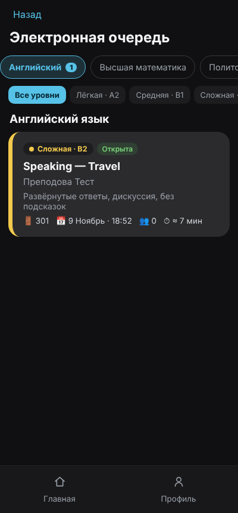
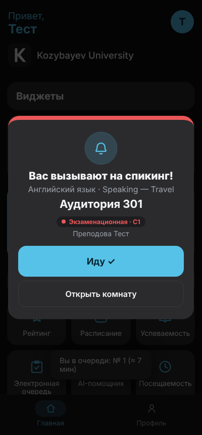
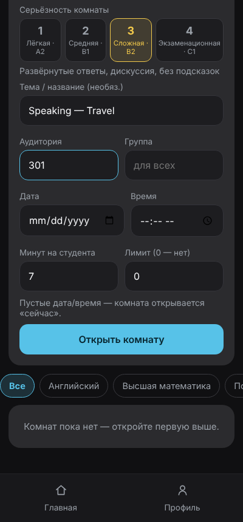
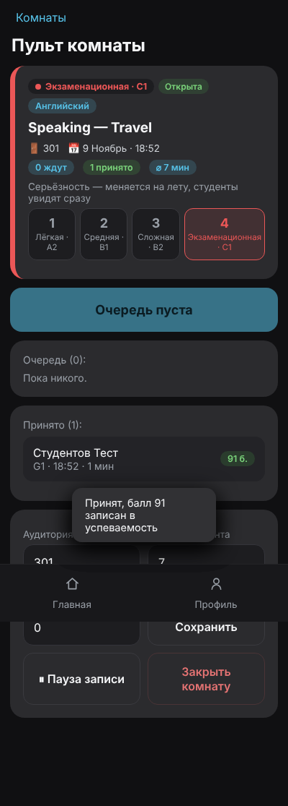

<div align="center">

# 🎓 KU Portal

**Студенческий и преподавательский портал Kozybayev University**

Электронная очередь на спикинг · Расписание · Оценки и рейтинг · AI-помощник


[](https://render.com/deploy?repo=https://github.com/SAKEDA-hub/ku-portal)

</div>

---

## 📑 Содержание

- [Возможности](#-возможности)
- [Скриншоты](#-скриншоты)
- [Быстрый старт](#-быстрый-старт-локально)
- [Как пользоваться](#-как-пользоваться)
- [Электронная очередь: подробно](#-электронная-очередь-подробно)
- [Публикация в интернете (Render)](#-публикация-в-интернете-render)
- [AI-помощник (Ollama)](#-ai-помощник-ollama)
- [Структура проекта](#-структура-проекта)
- [API](#-api)
- [FAQ](#-faq)

---

## ✨ Возможности

| | Студент | Преподаватель |
|---|---|---|
| 🎤 **Электронная очередь** | Вкладки по предметам, запись в комнату, номер и время ожидания, окно «Вас вызывают» | Комнаты с выбором **серьёзности**, пульт вызова, приём с баллом |
| 📅 **Расписание** | Расписание своей группы, ближайшее занятие на главной | Добавление занятий для групп |
| 📊 **Оценки** | Успеваемость, средний балл, рейтинг в группе | Выставление баллов студентам |
| 🤖 **AI-помощник** | Ответы на вопросы о вузе по данным сайта ku.edu.kz | То же |

Технически:

- ⚡ **Ноль зависимостей**: только встроенные модули Node.js, `npm install` не нужен.
- 🔴 **Realtime**: обновления приходят мгновенно через Server-Sent Events, без перезагрузки страницы.
- 📱 **Мобильный интерфейс**: тёмная тема, удобно с телефона.
- 💾 **Хранилище**: файл `data/db.json` с атомарной записью, без отдельной БД.

---

## 📸 Скриншоты

| Вкладки предметов (студент) | Вызов на спикинг (студент) |
|:---:|:---:|
|  |  |
| **Новая комната (преподаватель)** | **Пульт комнаты (преподаватель)** |
|  |  |

---

## 🚀 Быстрый старт (локально)

Нужен только **[Node.js 18+](https://nodejs.org/)**. Проверить версию: `node -v`.

```bash
git clone https://github.com/SAKEDA-hub/ku-portal.git
cd ku-portal
node server.js
```

Откройте в браузере **http://localhost:3000**.

> 💡 Другой порт: `PORT=8080 node server.js` (Windows PowerShell: `$env:PORT=8080; node server.js`).

**Как открыть с телефона в той же Wi-Fi-сети:** узнайте локальный IP компьютера (`ipconfig` на Windows, `ifconfig` / `ip a` на macOS и Linux) и откройте на телефоне `http://<IP>:3000`.

---

## 📖 Как пользоваться

Демо-данных нет: всё создаётся через интерфейс. Чтобы попробовать очередь, удобно открыть **два браузера** (или обычное окно и окно инкогнито): в одном преподаватель, в другом студент.

### 👨‍🎓 Студенту

1. **Регистрация** → роль **«Студент»** → укажите **группу** (например, `ИСУ-26-2-а`).
2. На главной откройте **«Электронная очередь»**.
3. Выберите вкладку предмета: **Английский, Высшая математика, Политология, Экология, Экономика, Введение в ИТ**.
4. При желании отфильтруйте комнаты по серьёзности (Лёгкая / Средняя / Сложная / Экзаменационная).
5. Откройте комнату и нажмите **«Встать в очередь»**. Разрешите уведомления, если браузер спросит.
6. Вы увидите **свой номер**, прогресс и **примерное время ожидания**.
7. Когда преподаватель вас вызовет, на **любой странице** портала появится окно **«Вас вызывают на спикинг!»** с номером аудитории, звуком и вибрацией. Нажмите **«Иду ✓»**.
8. После ответа придёт уведомление; если преподаватель поставил балл, он появится в **«Успеваемости»**.

> ⚠️ По одному предмету можно стоять только в **одной** очереди. Чтобы перейти в другую комнату того же предмета, сначала выйдите из текущей.

### 👩‍🏫 Преподавателю

1. **Регистрация** → роль **«Преподаватель»**.
2. Главная → **«Электронная очередь»** → **«＋ Новая комната для спикинга»**.
3. Выберите:
   - **предмет**: от него зависит, в какой вкладке студенты увидят комнату;
   - **серьёзность** от 1 до 4 (для английского показывается и уровень CEFR);
   - тему, аудиторию, группу (если пусто — комната для всех), минуты на студента, лимит очереди.
4. Нажмите **«Открыть комнату»**, откроется **пульт**:
   - **📣 Вызвать следующего**: студенту сразу приходит уведомление;
   - **Принять**: можно ввести балл 0–100, он автоматически запишется в успеваемость;
   - **↩︎**: вернуть в начало очереди (студент вышел на минуту);
   - **Нет**: студент не пришёл. Позже его можно вернуть кнопкой «В очередь»;
   - **✕**: убрать из очереди;
   - **Серьёзность** можно переключить в любой момент, студенты увидят изменение сразу;
   - **⏸ Пауза записи**: новые студенты не могут записаться, очередь сохраняется;
   - **Закрыть комнату**: всем, кто остался в очереди, придёт отмена.
5. Расписание и оценки находятся в разделах **«Добавить занятие»** и **«Оценки»** на главной.

---

## 🎤 Электронная очередь: подробно

### Уровни серьёзности

| # | Уровень | CEFR (англ.) | Формат |
|:-:|---|:-:|---|
| 1 | 🟢 Лёгкая | A2 | Разминка, базовые вопросы, можно подсказки |
| 2 | 🔵 Средняя | B1 | Стандартный формат, уточняющие вопросы |
| 3 | 🟡 Сложная | B2 | Развёрнутые ответы, дискуссия, без подсказок |
| 4 | 🔴 Экзаменационная | C1 | Строгий формат, оценка в ведомость |

### Жизненный цикл записи

```
            вызвать                принять (+балл)
 waiting ───────────────► called ───────────────► done
    │  ▲                    │
    │  └──── вернуть ◄──────┤ не пришёл
    │                       ▼
    │                    absent ──── вернуть ───► waiting
    ├─ вышел сам ──► left
    ├─ убран ──────► removed
    └─ комната закрыта ──► cancelled
```

### Как работает realtime

1. После входа клиент получает **одноразовый ticket** (`POST /api/events/ticket`, действует 60 секунд).
2. Затем открывает поток **SSE** `GET /api/events?ticket=…`. Постоянный токен в URL не попадает.
3. Сервер шлёт только **сигналы** вида «комната X изменилась» или «вас вызвали». Сами данные клиент перечитывает через обычный API, где проверяются права, поэтому чужие данные в поток не утекают.
4. При обрыве связи клиент переподключается с нарастающей паузой (1 → 2 → 4 … 30 с), а пока связи нет, опрашивает сервер раз в 5 секунд.

### Время ожидания

ETA = позиция × средняя длительность ответа. Средняя считается по последним 8 принятым студентам этой комнаты. Пока принятых меньше двух, берётся «минут на студента» из настроек комнаты.

---

## 🌍 Публикация в интернете (Render)

Сайт можно бесплатно выложить в интернет, чтобы им пользовались другие люди. В репозитории уже есть `render.yaml`.

### Вариант 1: в один клик

1. Нажмите кнопку **[Deploy to Render](https://render.com/deploy?repo=https://github.com/SAKEDA-hub/ku-portal)**.
2. Войдите через **GitHub**.
3. Нажмите **Apply**. Через 1–3 минуты появится ссылка вида `https://ku-portal-xxxx.onrender.com`. Эту ссылку и отправляйте людям.

### Вариант 2: вручную

1. https://render.com → **Sign in with GitHub**.
2. **New +** → **Blueprint** → выберите репозиторий `ku-portal` → **Apply**.
3. Каждый `git push` в ветку `main` автоматически обновляет сайт (`autoDeploy: true`).

### ⚠️ Ограничения бесплатного тарифа

- Сервис **засыпает** после ~15 минут без посетителей, первый заход после этого грузится 30–60 секунд.
- **`data/db.json` сбрасывается** при каждом перезапуске или деплое: аккаунты и очереди не сохраняются надолго. Для постоянного хранения нужен платный **Persistent Disk** на Render (смонтировать в `/opt/render/project/src/data`) или любой VPS.
- **Ollama** на хостинге недоступна, поэтому AI-помощник там работает в режиме поиска по сайту ku.edu.kz.

> ℹ️ **GitHub Pages не подойдёт**: он отдаёт только статические файлы, а порталу нужен Node.js-сервер (API, очередь, SSE). Поэтому используется Render (подойдут и Railway, Fly.io или любой VPS).

### Свой сервер (VPS)

```bash
git clone https://github.com/SAKEDA-hub/ku-portal.git && cd ku-portal
PORT=3000 node server.js
```

Для постоянной работы удобно запускать через `pm2` (`npm i -g pm2 && pm2 start server.js --name ku-portal`) и поставить перед ним nginx. Для SSE в nginx нужны `proxy_buffering off;` и `proxy_read_timeout 1h;`.

---

## 🤖 AI-помощник (Ollama)

Помощник отвечает на вопросы о вузе. При старте сервер сам собирает тексты с сайта https://ku.edu.kz/ru/ и подставляет их в промпт (RAG).

```bash
ollama serve                 # запустить Ollama
ollama pull qwen2.5:1.5b     # скачать модель (один раз)
node server.js
```

- Модель меняется переменной окружения: `OLLAMA_MODEL=llama3.2:1b node server.js`.
- Адрес Ollama: `OLLAMA_URL=http://127.0.0.1:11434`.
- Без Ollama помощник не падает: он отвечает фразами, найденными на сайте ku.edu.kz.

---

## 🗂 Структура проекта

```
ku-portal/
├── server.js          # HTTP-сервер, API, очередь, SSE, AI — без зависимостей
├── public/
│   ├── index.html     # точка входа SPA
│   ├── app.js         # весь фронтенд (vanilla JS, hash-роутер)
│   └── style.css      # тёмная мобильная тема
├── data/              # создаётся автоматически: db.json, кэш сайта KU
├── docs/screenshots/  # картинки для README
├── render.yaml        # конфиг бесплатного деплоя на Render
└── package.json
```

---

## 🔌 API

Все запросы, кроме входа и регистрации, требуют заголовок `Authorization: Bearer <token>`.

<details>
<summary><b>Аутентификация и общее</b></summary>

| Метод | Путь | Описание |
|---|---|---|
| POST | `/api/auth/register` | Регистрация |
| POST | `/api/auth/login` | Вход |
| POST | `/api/auth/logout` | Выход |
| GET | `/api/me` | Текущий пользователь |
| GET | `/api/schedule` | Расписание (группы или преподавателя) |
| POST | `/api/events/ticket` | Одноразовый ticket для SSE |
| GET | `/api/events?ticket=` | Поток событий (SSE) |
</details>

<details>
<summary><b>Электронная очередь: студент</b></summary>

| Метод | Путь | Описание |
|---|---|---|
| GET | `/api/queue/meta` | Список дисциплин и уровней |
| GET | `/api/exam/sessions?discipline=&level=` | Комнаты вкладки, счётчики, мои очереди |
| GET | `/api/exam/sessions/:id` | Комната, моя позиция, очередь |
| POST | `/api/exam/sessions/:id/join` | Встать в очередь |
| POST | `/api/exam/queue/leave` | Выйти (`{ entryId }`) |
| POST | `/api/exam/queue/:id/ack` | Подтвердить вызов («Иду») |
</details>

<details>
<summary><b>Электронная очередь: преподаватель</b></summary>

| Метод | Путь | Описание |
|---|---|---|
| GET / POST | `/api/teacher/sessions` | Мои комнаты / создать комнату |
| PATCH | `/api/teacher/sessions/:id` | `level`, `status` (open/paused/closed), `room`, `title`, `slotMin`, `capacity` |
| GET | `/api/teacher/sessions/:id/queue` | Вызванные, ожидающие, принятые, неявки |
| POST | `/api/teacher/sessions/:id/call-next` | Вызвать следующего |
| POST | `/api/teacher/queue/:id/call` | Вызвать конкретного студента |
| POST | `/api/teacher/queue/:id/accept` | Принять (`{ score? }`) |
| POST | `/api/teacher/queue/:id/absent` | Не пришёл |
| POST | `/api/teacher/queue/:id/requeue` | Вернуть (`{ front? }`) |
| POST | `/api/teacher/queue/:id/remove` | Убрать из очереди |
</details>

<details>
<summary><b>Оценки, расписание, AI</b></summary>

| Метод | Путь | Описание |
|---|---|---|
| GET | `/api/student/dashboard` | Балл и ближайшее занятие |
| GET | `/api/grades` · `/api/rating` | Успеваемость · рейтинг группы |
| GET / POST | `/api/teacher/subjects` | Предметы преподавателя |
| POST | `/api/teacher/schedule` | Добавить занятие |
| POST | `/api/teacher/grades` | Выставить балл |
| GET | `/api/teacher/students?group=` | Студенты группы |
| POST | `/api/ai/chat` · GET `/api/ai/status` | AI-помощник |
</details>

---

## ❓ FAQ

**Порт 3000 занят.** Запустите на другом: `PORT=3001 node server.js`.

**Как сбросить все данные?** Остановите сервер и удалите `data/db.json`.

**Студент не видит комнату.** Проверьте, что группа в комнате совпадает с группой студента символ в символ, либо оставьте поле группы пустым (тогда комната для всех). Ещё стоит проверить, что открыта нужная вкладка и комната не закрыта.

**Нет звука или уведомления при вызове.** Браузеры разрешают звук только после того, как пользователь хоть раз нажал на страницу. Системные уведомления нужно разрешить в браузере. Окно вызова внутри портала появляется в любом случае.

---

<div align="center">

Основано на проекте [stikech/ku-portal](https://github.com/stikech/ku-portal) · Kozybayev University, Костанай

</div>
