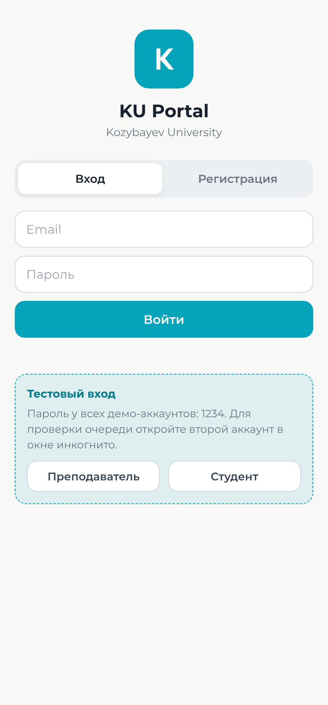
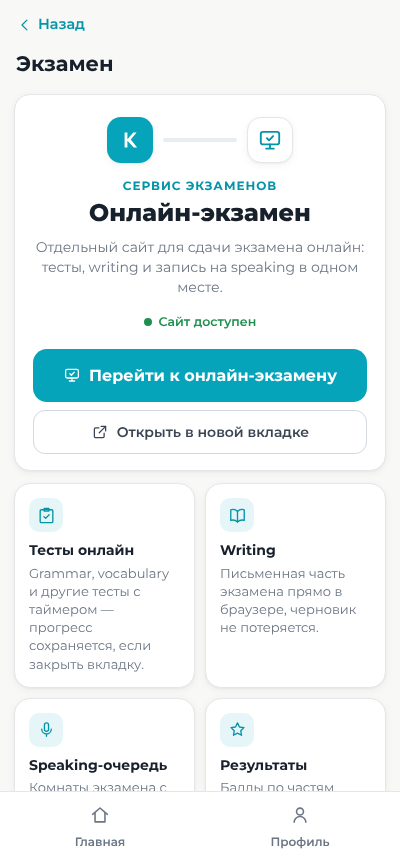
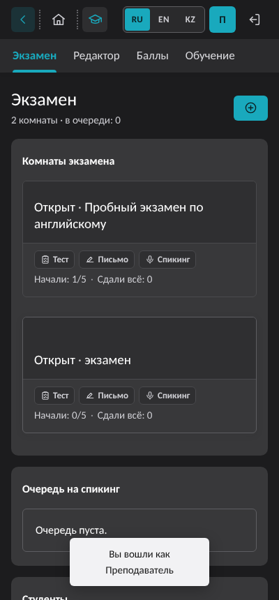

# KU Portal

Портал для студентов и преподавателей Kozybayev University: расписание, оценки, рейтинг группы, онлайн-экзамен и помощник по вопросам о вузе.

Работает на чистом Node.js, внешние зависимости не нужны.

**Сайт: https://ku-portal.onrender.com** (тестовый вход — на экране входа, пароль `1234`)

[](https://render.com/deploy?repo=https://github.com/SAKEDA-hub/ku-portal)

| Вход | Раздел «Экзамен» | Онлайн-экзамен |
|:---:|:---:|:---:|
|  |  |  |

## Запуск

Нужен Node.js 18 или новее.

```bash
git clone https://github.com/SAKEDA-hub/ku-portal.git
cd ku-portal
node server.js
```

Портал откроется по адресу http://localhost:3000. С телефона в той же Wi-Fi сети: `http://<IP компьютера>:3000`.

## Тестовые аккаунты

Создаются автоматически при первом запуске. Пароль у всех: `1234`.

| Роль | Email |
|---|---|
| Преподаватель | `teacher@demo.kz` |
| Студент | `student@demo.kz` |
| Студент | `student2@demo.kz` |

На экране входа есть кнопки быстрого входа.

Отключить демо-данные: `DEMO=0 node server.js`.

## Онлайн-экзамен

Раздел «Экзамен» (на главной в «Сервисах» и в профиле) сразу предлагает перейти в **«Онлайн-экзамен»** — сервис [exam-sync](https://github.com/StephCurrysvg/exam-sync), встроенный в этот же сервер по адресу `/exam-sync/`. Отдельный деплой не нужен.

- **Преподаватель:** редактор тестов, комнаты экзамена (тест + writing + speaking), очередь на speaking, ведомость.
- **Студент:** тесты с таймером, writing, запись на speaking, результаты.
- Вход в онлайн-экзамен отдельный: студенты `user`, `user1`–`user4` / `1`, преподаватель `teacher` / `admin`.
- Вернуться в портал — кнопка «KU Portal» в верхней панели сайта экзаменов.
- Данные экзаменов — `data/exam-sync.json` (создаётся сам; при первом запуске берутся демо-данные из `exam-sync/seed.json`).

## Публикация для других людей

Рабочая версия уже опубликована: https://ku-portal.onrender.com. Ниже — как развернуть свою копию.

GitHub Pages не подходит: порталу нужен сервер. Бесплатный вариант — Render, настройки уже лежат в `render.yaml`.

1. Нажать кнопку **Deploy to Render** выше и войти через GitHub.
2. Нажать **Apply**. Через пару минут появится ссылка вида `https://ku-portal-xxxx.onrender.com`, её можно отправлять людям.
3. После каждого `git push` в `main` сайт обновляется сам. Если этого не происходит — в Render: **Manual Deploy → Deploy latest commit**, а на GitHub дайте приложению Render доступ к репозиторию (Settings → Applications → Render → Configure).

Ограничения бесплатного тарифа:
- после 15 минут без посетителей сервер засыпает, первое открытие после этого занимает около минуты;
- при перезапуске база (`data/db.json`, `data/exam-sync.json`) очищается, а тестовые аккаунты создаются заново. Чтобы данные сохранялись, нужен платный Persistent Disk или свой сервер.

## Настройки

| Переменная | По умолчанию | Назначение |
|---|---|---|
| `PORT` | `3000` | Порт сервера |
| `DEMO` | включено | `0` — не создавать тестовые аккаунты |
| `OLLAMA_URL` | `http://127.0.0.1:11434` | Адрес Ollama для помощника |
| `OLLAMA_MODEL` | `qwen2.5:1.5b` | Модель помощника |

Помощник по вопросам о вузе использует локальную модель через [Ollama](https://ollama.com) и тексты с сайта ku.edu.kz. Без Ollama он отвечает найденными на сайте фрагментами.

## Устройство

- `server.js` — HTTP-сервер и API (вход, расписание, оценки, рейтинг, AI-помощник); подключает `exam-sync/`.
- `public/` — одностраничный интерфейс (HTML, CSS, JavaScript), шрифт Montserrat лежит локально.
- `exam-sync/` — встроенный сервис «Онлайн-экзамен» (`handler.js` — сервер синхронизации, `index.html` — интерфейс).
- `data/db.json` — данные, создаются автоматически.

На основе проекта [stikech/ku-portal](https://github.com/stikech/ku-portal).
